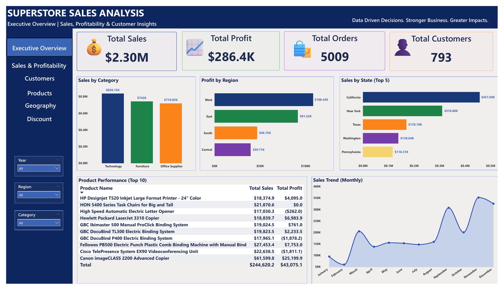
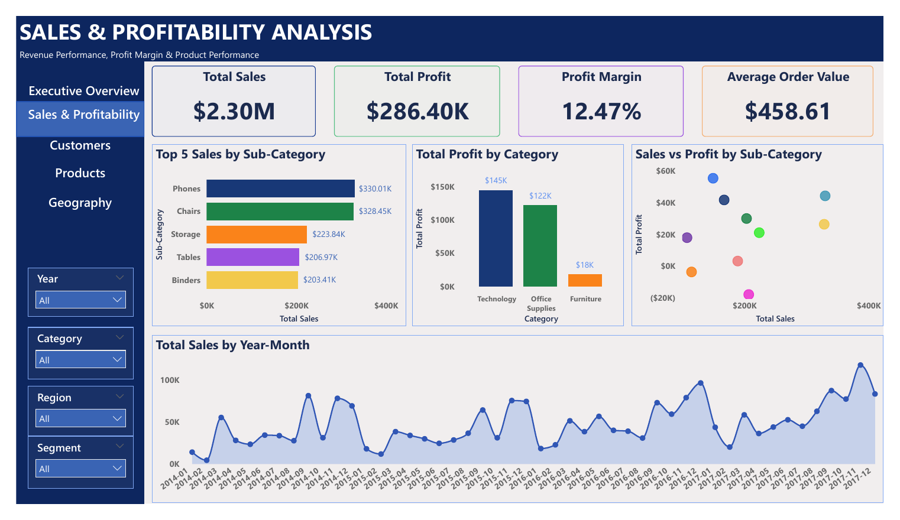
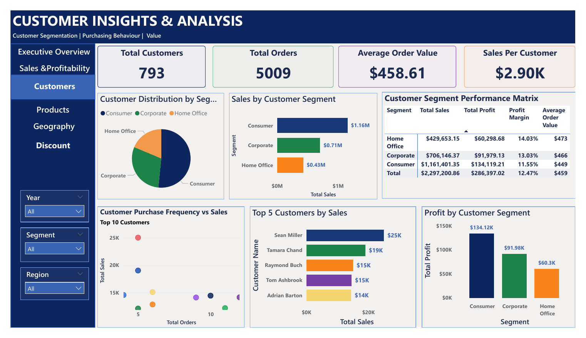
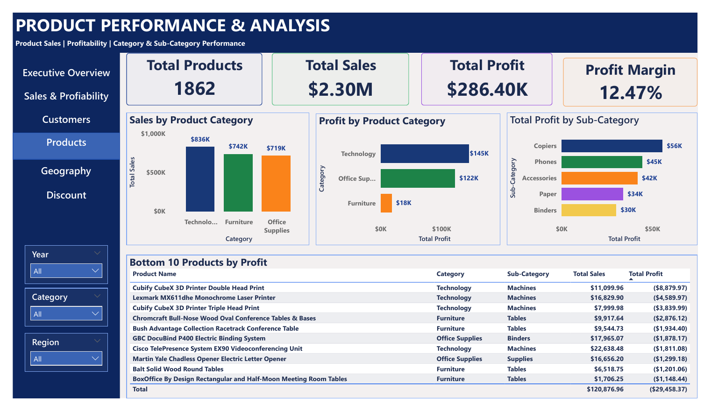
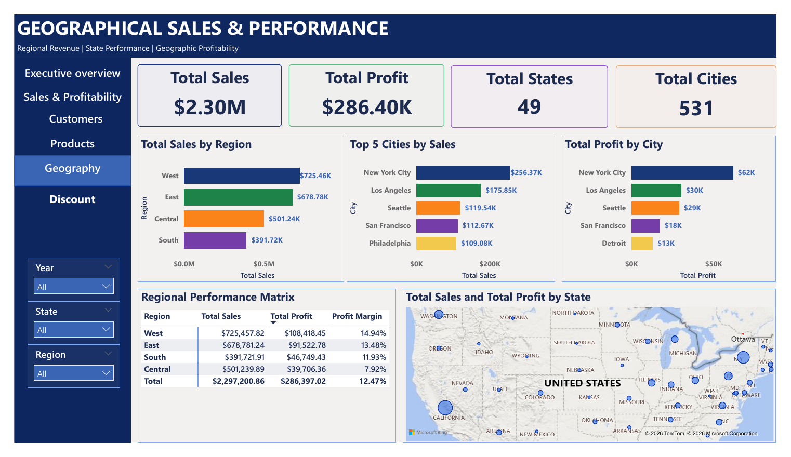
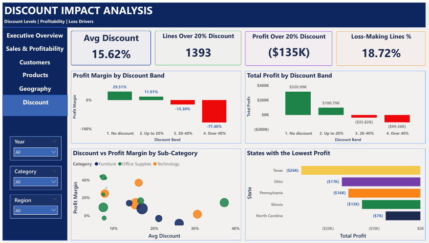
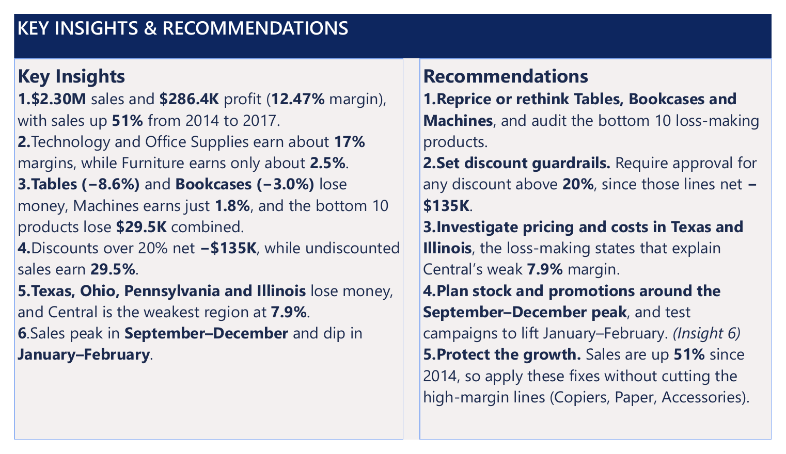

# 📊 Superstore Sales Analysis — Power BI Dashboard

> **Data Driven Decisions. Stronger Business. Greater Impacts.**

An interactive, seven-page Power BI report that analyses **$2.30M in sales across 5,009 orders and 793 customers (2014–2017)**. It answers five practical business questions: *what sells, what makes money, who buys, where, and how discounting affects profit.*



---

## 🎯 Business Questions

1. How are sales and profit performing overall, and how do they trend over time?
2. Which categories, sub-categories and products drive revenue, and which lose money?
3. Which customer segments and individual customers are most valuable?
4. Which regions, states and cities perform best, and where is profitability weak?
5. How do discounts affect profitability, and where do they cost the business money?

## 🔑 Headline KPIs

| Metric | Value |
|---|---|
| Total Sales | **$2.30M** |
| Total Profit | **$286.4K** |
| Profit Margin | **12.47%** |
| Total Orders | **5,009** |
| Total Customers | **793** |
| Average Order Value | **$458.61** |
| Sales per Customer | **$2.90K** |
| Total Products | **1,862** |
| States / Cities | **49 / 531** |

## 🗂️ Report Pages

| # | Page | What it shows |
|---|---|---|
| 1 | **Executive Overview** | Headline KPIs, sales by category, profit by region, top 5 states, top 10 products, monthly sales trend |
| 2 | **Sales & Profitability** | Top 5 sub-categories, profit by category, sales vs profit by sub-category scatter, sales by year-month (2014–2017) |
| 3 | **Customer Insights & Analysis** | Segment distribution and performance matrix, top 5 customers, purchase frequency vs sales |
| 4 | **Product Performance & Analysis** | Sales and profit by category and sub-category, bottom 10 products by profit |
| 5 | **Geographical Sales & Performance** | Sales by region, top cities by sales and profit, regional performance matrix, state map |
| 6 | **Discount Impact Analysis** | Average discount, lines over 20% discount and their profit, loss-making lines %, margin and profit by discount band, discount vs margin by sub-category, states with the lowest profit |
| 7 | **Key Insights & Recommendations** | Summary of the main findings and recommended actions |

Pages 1–6 have slicers (Year, Region, Category, Segment, State, Order Date, depending on the page) and page navigation.

### Screenshots

| Sales & Profitability | Customer Insights |
|---|---|
|  |  |

| Product Performance | Geographical Performance |
|---|---|
|  |  |

| Discount Impact | Key Insights & Recommendations |
|---|---|
|  |  |

## 💡 Key Insights

Dashboard figures were reconciled to the source data (see [`data/README.md`](data/README.md)). Findings marked *(from the dataset)* were calculated from the source data and are summarised on the Insights page rather than charted directly.

**Sales & profit**
- **Technology** leads on both sales ($836K) and profit ($145K). **Furniture** is the weak spot: $742K in sales but only **$18K profit (~2.5% margin)**, against roughly 17% for Technology and Office Supplies. *(from the dataset)* The drag comes from **Tables (−$17.7K, −8.6% margin)** and **Bookcases (−$3.5K)**.
- **Phones ($330K)** and **Chairs ($328K)** are the top sub-categories by sales. **Copiers** lead on profit ($56K), followed by Phones ($45K) and Accessories ($42K).
- Sales are **strongly seasonal**: September, November and December are the peaks, while January and February are the lows. Year-on-year, monthly peaks rise across 2014–2017.

**Products**
- **Canon imageCLASS 2200 Advanced Copier** is the top product: $61.6K sales and $25.2K profit.
- The **bottom 10 products by profit** combine for about **−$29.5K profit on $120.9K sales**. Four are **Machines** (Cubify CubeX double- and triple-head 3D printers, Lexmark MX611dhe laser printer, Cisco TelePresence EX90), which account for about **$19.1K (65%)** of that loss; the Cubify Double Head Print alone loses **$8.9K on $11.1K sales**. Four are **Tables** (Furniture). Tables is a top-5 sub-category by sales ($207K) but loses money overall.
- Several high-revenue products **lose money or break even**: Cisco TelePresence EX90 (−$1.8K), GBC DocuBind P400 (−$1.9K), High Speed Automatic Electric Letter Opener (−$262) and HON 5400 Task Chairs (≈$0 on $21.9K sales).

**Customers**
- **Consumer** is the largest segment ($1.16M sales, $134K profit), but **Home Office** has the best margin (**14.03%**) and highest average order value ($472.67). Consumer has the lowest margin (11.55%).
- Top customers by sales: Sean Miller ($25K), Tamara Chand ($19K), Raymond Buch ($15K), Tom Ashbrook ($15K), Adrian Barton ($14K).

**Geography**
- **West** leads on sales ($725K) and profit ($108K). Profit margin by region (calculated from the dashboard figures) is West ≈ 14.9%, East ≈ 13.5%, South ≈ 11.9%, Central ≈ 7.9%.
- **California ($458K)** and **New York ($311K)** are the top states; **New York City** is the top city on both sales ($256K) and profit ($62K).

**Discounting** (Discount Impact page)
- Profitability falls sharply as discounts rise. Margin by discount level: **no discount 29.5%**, up to 20% **11.9%**, over 20% to 40% **−15.3%**, over 40% **−77.4%**.
- Lines discounted by more than 20% (1,393 lines, about 14% of the total) net **−$135K profit**, which is larger than the −$29.5K lost by the bottom 10 products. Discounting is associated with the losses in Tables, Machines and several states, though the data alone doesn't prove it is the cause.

**States** (Discount Impact page)
- **Texas (−$25.7K on $170K sales)**, **Ohio (−$17.0K)**, **Pennsylvania (−$15.6K)** and **Illinois (−$12.6K)** have the lowest profit. Texas and Illinois sit in the Central region and explain its weak ~7.9% margin.

**Growth** *(from the dataset)*
- Sales grew from **$484K in 2014 to $733K in 2017 (+51%)**, and profit from $49.5K to $93.4K.

## 🧠 Recommendations

1. **Reprice or rethink Tables, Bookcases and Machines**, and audit the bottom 10 loss-making products.
2. **Set discount guardrails.** Require approval for any discount above 20%, since those lines net about −$135K.
3. **Investigate pricing and costs in Texas and Illinois**, the loss-making states that explain Central's weak ~7.9% margin.
4. **Plan stock and promotions around the September–December peak**, and test campaigns to lift January–February.
5. **Protect the growth.** Sales are up 51% since 2014, so apply these fixes without cutting the high-margin lines (Copiers, Paper, Accessories).

## 🛠️ Tools & Skills

- **Power BI Desktop**: data modelling, DAX measures, interactive visuals, slicers, page navigation
- **DAX**: KPI measures (see [`docs/kpi-definitions.md`](docs/kpi-definitions.md))
- **Python (Pandas, Plotly)**: exploratory analysis in [`notebooks/superstore_eda.ipynb`](notebooks/superstore_eda.ipynb)
- **Data visualisation & dashboard design**: consistent colour palette, KPI cards, drill-down by region/segment/category

## 🐍 Python EDA

The notebook [`notebooks/superstore_eda.ipynb`](notebooks/superstore_eda.ipynb) explores the same dataset with Pandas and Plotly before the dashboard build: data checks, sales and profit by category, sub-category, region and segment, annual trends, shipping times, and discount vs profit. It also confirms the headline figures: $2,297,200.86 sales, $286,397.02 profit, 37,873 units sold, 15.62% average discount and 3.96 days average shipping time.

## 📁 Repository Structure

```
superstore-sales-powerbi/
├── README.md
├── LICENSE
├── .gitignore
├── dashboard/
│   └── Superstore_Sales_Analysis_Dashboard.pdf   # full 5-page export
├── images/                                       # page screenshots used in this README
├── notebooks/
│   └── superstore_eda.ipynb                      # Python EDA (Pandas, Plotly)
├── docs/
│   ├── insights.md                               # extended findings
│   └── kpi-definitions.md                        # KPI and measure definitions
└── data/
    └── README.md                                 # data source and how to reproduce
```

> The `.pbix` file can be added to `dashboard/` (see the note in `data/README.md`).

## ▶️ How to Explore

1. Open the PDF in [`dashboard/`](dashboard/) for a quick look at all five pages.
2. For the interactive version, download the `.pbix` file (if included) and open it in **Power BI Desktop**.
3. Use the slicers (Year, Region, Category, Segment) to filter every visual on the page.

## 👩🏾‍💻 Author

**Sarah Odinakachukwu Oko**: Business & Data Analyst | Agricultural Economist, Abuja, Nigeria

- LinkedIn: [linkedin.com/in/sarah-oko-662305262](https://linkedin.com/in/sarah-oko-662305262)
- GitHub: [github.com/Saraiemmanuelz](https://github.com/Saraiemmanuelz)
- Email: Okoodinakachukwu@gmail.com

## 📄 License

Released under the [MIT License](LICENSE).
